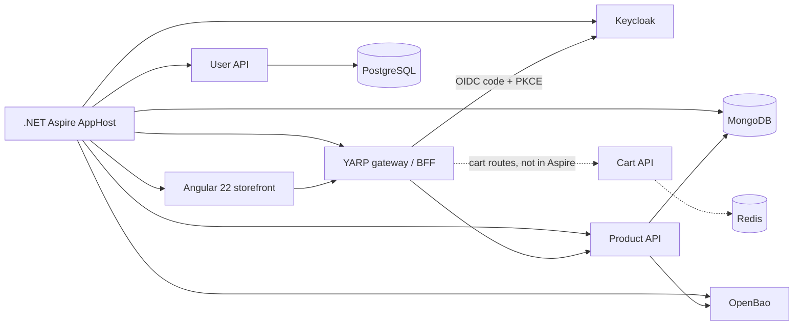

# HardwareNexus

> **🧩 A full-stack platform for discovering and shopping for PC hardware.**

HardwareNexus is a modular hardware-commerce platform for browsing computer components, managing user accounts, and building shopping carts. It brings together an Angular storefront, .NET 10 APIs, a YARP gateway acting as a backend-for-frontend (BFF) with Keycloak sign-in, and an Aspire-powered local development environment.

> **🚧 Project status:** active development. The product catalog and Keycloak sign-in are the integrated vertical slice. The User API runs in Aspire but its legacy sign-in flow has been superseded by the gateway. The Cart API is implemented as a standalone service and is not yet part of the Aspire topology; the Order API is an empty scaffold.

## ✨ What you can do

- **Browse components** — explore CPUs, GPUs, and coolers, with product detail pages and CPU filters.
- **Sign in** — authenticate through Keycloak via the gateway, view a dashboard, and sign out.
- **Build a cart** — add, view, and remove cart items through the Redis-backed Cart API (run separately).
- **Run the platform locally** — launch the integrated development environment from one Aspire AppHost.

## 🏗️ Architecture



The AppHost arranges resources into **Website**, **Api**, and **Infrastructure** groups. It starts:

- **MongoDB** (`mongo:7`) and a seed step that imports the hardware catalog from `Scripts/MongoDB/products.json`,
- **OpenBao** in dev mode and a seed step that creates AppRole credentials and application secrets,
- **Keycloak** on port `8080`, importing the `hardware-nexus` realm from `Scripts/Keycloak/hardware-nexus-realm.json`,
- the **User API** and **Product API**,
- the **gateway** and the **Angular dev server**.

PostgreSQL, Redis, the Cart API, and the Order API are **not** started by the AppHost.

### Authentication

The gateway is the session owner. `/gateway/user/login` starts an OpenID Connect authorization-code flow (with PKCE) against Keycloak's `hardware-nexus` realm using the confidential `gateway` client. After sign-in the gateway keeps the session in an HTTP-only `hn-bff` cookie scoped to `/gateway`; the Angular client never handles tokens. Unauthenticated calls to `/gateway/*` endpoints that require authorization return `401` instead of a redirect. Self-registration is enabled in the Keycloak realm.

The User API still contains an older email/password flow (`/user/signin` issuing an `access_token` JWT cookie, `/user/signup`, `/user/accountverification`), but the gateway no longer routes to it.

## 🧰 Technology stack

| Area | Technologies |
| --- | --- |
| Storefront | Angular 22, TypeScript, Bootstrap, RxJS, NgRx Signals, Font Awesome |
| APIs | ASP.NET Core / .NET 10, Controllers, Swagger / OpenAPI |
| Application patterns | Product API: single project with Autofac and keyed Mongo repositories. User and Cart APIs: Clean Architecture layers with MediatR (User API also FluentValidation) |
| Gateway | YARP reverse proxy, cookie authentication + OpenID Connect (Keycloak) |
| Data | MongoDB (catalog), PostgreSQL + EF Core (users), Redis (cart) |
| Secrets | OpenBao (AppRole) read through VaultSharp |
| Local orchestration | .NET Aspire 13, Docker, OpenBao, Keycloak |
| Tests | xUnit, Moq, ASP.NET Core integration-test infrastructure |

## 🛍️ Features

- **Product catalog** for **CPU**, **GPU**, and **Cooler** categories: list by category, item details, and filters (implemented for CPU only; GPU and Cooler filters are not implemented yet). Create, update, and delete endpoints exist and are role-protected (`Create`, `Update`, `Delete`) but are not exposed through the gateway.
- **Gateway sign-in** with Keycloak, current-user lookup (`preferred_username`, `email`), and sign-out.
- **User API** with registration, legacy sign-in, current-user lookup, sign-out, account verification, deletion, password hashing, EF Core migrations applied on startup, and development seeding.
- **Cart API** backed by Redis with add, retrieve, and remove-item operations, MediatR command/query handlers, and cart expiry configurable through `CART_EXPIRATION_MINUTES`.
- **Angular storefront** with category navigation, product lists and detail pages, CPU filters, a Keycloak sign-in screen, a protected dashboard (`authGuard`), and session state in an NgRx Signal Store. Cart and sign-up components exist but are not wired into the router yet.
- **Bootstrap scripts** for MongoDB (catalog import) and OpenBao (AppRole and secret setup). The OpenBao seed is meant to stay idempotent.

## 📁 Repository layout

```text
Aspire/
  Aspire.Host/                 Development orchestrator, options, and seed scripts
    Scripts/MongoDB/           Catalog data and import script
    Scripts/OpenBao/           AppRole and secret seeding
    Scripts/Keycloak/          hardware-nexus realm export
Services/
  Product/                     MongoDB-backed catalog API (ProductApi.Api) and tests
  User/                        PostgreSQL-backed user API (Presentation/Application/Domain/Infrastructure) and tests
  Cart/                        Redis-backed cart API (Presentation/Application/Domain/Infrastructure) and tests
  Order/                       Order API project scaffold (no behavior yet)
Website/
  Website.Client/              Angular storefront
    src/app/business/          Feature areas: products, user, cart (api / components / models)
    src/app/shared/            Shared components, models, services, and the session store
  Website.Gateway/             YARP gateway / BFF with Keycloak sign-in
HardwareNexus.slnx             Top-level .NET solution
```

## 🚀 Get started

### Before you begin

- [.NET SDK 10](https://dotnet.microsoft.com/download/dotnet/10.0)
- [Node.js](https://nodejs.org/) and npm (the client's Dockerfile builds with Node 20)
- Docker Desktop or another Docker-compatible runtime, running locally
- PostgreSQL on `localhost:5432` for the User API (not provisioned by the AppHost)

The AppHost reads infrastructure settings (OpenBao AppRoles, MongoDB, Keycloak admin, PostgreSQL) from `Aspire/Aspire.Host/appsettings.Development.json` and, optionally, from `Aspire/Aspire.Host/Properties/dev.secrets.json` (not tracked by git). Put local overrides in that file, in user secrets, or in environment variables — never commit real credentials.

### Start the full platform

From the repository root:

```bash
npm ci --prefix Website/Website.Client
dotnet restore HardwareNexus.slnx
dotnet run --project Aspire/Aspire.Host
```

Aspire opens its dashboard with the endpoints, logs, and health of every resource. Default local addresses:

| Component | Address |
| --- | --- |
| Storefront | `http://localhost:8100` |
| Gateway | `https://localhost:7100/gateway` |
| User API | `https://localhost:7002` |
| Product API | `https://localhost:7003` |
| Keycloak | `http://localhost:8080` (realm `hardware-nexus`) |
| OpenBao | `http://localhost:8200` |
| MongoDB | `localhost:27017` |

### Work on the frontend only

```bash
npm --prefix Website/Website.Client start
```

This serves the storefront on port `8100`. It talks to the gateway at the address in `src/environments/environment.ts`, so the gateway (and whatever it routes to) must be running for data and sign-in to work.

### Create a production frontend bundle

```bash
npm --prefix Website/Website.Client run build
```

## 🔌 API surface

The gateway currently exposes the following endpoints. The APIs have more controller actions, available through their Swagger UIs when run directly.

| Gateway route | Method | Handled by |
| --- | --- | --- |
| `/gateway/product/{type}` | `GET` | Product API — list products by category |
| `/gateway/product/{type}/{id}` | `GET` | Product API — get a product |
| `/gateway/product/{type}/filters` | `GET` | Product API — get filters (CPU only) |
| `/gateway/user/login` | `GET` | Gateway — start Keycloak sign-in |
| `/gateway/user/me` | `GET` | Gateway — current user from the session (requires sign-in) |
| `/gateway/user/signout` | `GET`, `POST` | Gateway — end the gateway and Keycloak sessions |
| `/gateway/cart` | `GET`, `POST` | Cart API — requires sign-in and a separately running Cart API |

The storefront uses the category values `CPU`, `GPU`, and `COOLER` in routes.

## 🧪 Build and test

```bash
# Build the complete .NET solution
dotnet build HardwareNexus.slnx

# Run all .NET tests (needs the infrastructure described below)
dotnet test HardwareNexus.slnx

# Run tests that don't need infrastructure
dotnet test Services/Cart/tests/CartApi.Application.Test/CartApi.Application.Test.csproj
dotnet test Services/User/tests/UserApi.Application.Tests/UserApi.Application.Tests.csproj

# Build the Angular application
npm --prefix Website/Website.Client run build
```

### Testing notes

- **Cart:** application tests run on their own; the presentation test project has no discoverable tests.
- **User:** application tests run on their own; presentation tests apply migrations and need PostgreSQL on `localhost:5432`.
- **Product:** unit and integration tests; integration tests need OpenBao credentials (`OPENBAO_ADDR`, `OPENBAO_PRODUCT_ROLE_ID`, `OPENBAO_PRODUCT_SECRET_ID`) and a seeded MongoDB. Start Aspire first.
- **Angular:** `npm --prefix Website/Website.Client test` runs Karma + Jasmine, but there are no spec files yet. No linter is configured.

## 🗺️ Current integration boundaries

- Aspire starts the **User API** and **Product API**, but not the **Cart API**, **Order API**, **Redis**, or **PostgreSQL**.
- The gateway's cart cluster points at `http://cart-api:8080`, a container-network address that does not resolve in the Aspire setup.
- The gateway does not route to the User API; sign-in, current user, and sign-out are handled by the gateway with Keycloak. User registration and account verification exist only on the User API.
- In the storefront, the navigation links to `/cart` and the sign-in page links to `/user/sign-up`, but neither route is registered yet.
- The Product API's Swagger UI is still configured for Azure AD, not Keycloak.
- The Order API has project scaffolding only, with no domain behavior or endpoints.
- `Website.Client/compose.yaml` is a leftover from an earlier Azure-based setup and does not match the current project layout.

These boundaries describe the current checked-in state and are the next milestones for completing the commerce flow.

## 🔐 Security and configuration

- Services receive only `OPENBAO_ADDR` and per-service AppRole credentials (`OPENBAO_<SERVICE>_ROLE_ID`, `OPENBAO_<SERVICE>_SECRET_ID`) and should read everything else from OpenBao through VaultSharp. The Product API does this for its MongoDB connection string; the User API still reads its PostgreSQL credentials from configuration (`PostgresSql:*`).
- The gateway's Keycloak client secret and the AppHost's development credentials are currently stored in tracked `appsettings*.json` files. Treat them as local-only development values: move them to `dev.secrets.json`, user secrets, or environment variables, and rotate them before deploying anywhere beyond a local machine.
- In production, use TLS, keep secrets outside tracked files, and set `RequireHttpsMetadata` and cookie options appropriately.

## 🤝 Contributing

Keep changes scoped to one service where possible, add or update tests alongside behavior changes, and run the relevant build and test commands before opening a pull request. Use small, focused Conventional Commits (`feat:`, `fix:`, `refactor:`, `test:`). When adding a service to the integrated environment, update the Aspire AppHost (`GroupResourceExtensions.cs`) and the gateway routes and clusters, then reflect the change here. See [AGENTS.md](AGENTS.md) for detailed contributor and agent guidelines.
